# Đặc tả chức năng & luồng hệ thống — Website kết nối thuê trọ (MVP)

> **Mục đích:** chốt phạm vi MVP, thứ tự ưu tiên và luồng hệ thống, làm đầu vào cho bước thiết kế cơ sở dữ liệu

**Mục lục:** 1. Tóm tắt phân tích · 2. Vai trò & phân quyền · 3. Chức năng MVP & mô hình thu phí · 4. Chức năng để sau · 5. Luồng hệ thống · 6. Trạng thái & điều kiện hiển thị · 7. Quy tắc nghiệp vụ · 8. Đối tượng dữ liệu chính · 9. Danh sách màn hình · 10. Yêu cầu phi chức năng · 11. Câu hỏi cần chốt

---

## 1. Tóm tắt phân tích

### 1.1 Bài toán

Người thuê, chủ yếu là sinh viên tại TP.HCM, mất nhiều thời gian vì thông tin phòng phân tán, thiếu chính xác hoặc đã cũ, không rõ tổng chi phí mỗi tháng, khó tìm phòng gần trường và dễ gặp tin giả, lừa cọc. Chủ trọ khó tiếp cận đúng người thuê, phòng trống lâu và phải trả lời lặp lại cùng một nhóm câu hỏi. Một tin đăng được chuẩn hóa đầy đủ (chi phí, tiện nghi, quy định, tình trạng, vị trí) giải quyết cùng lúc vấn đề của cả hai phía, nên đây là trục chính của MVP.

### 1.2 Mục tiêu của MVP

MVP cần kiểm chứng hai giả thuyết:

1. Sinh viên tìm được phòng phù hợp nhanh hơn nhờ tìm theo trường và khoảng cách, thông tin chuẩn hóa, tổng chi phí rõ ràng và tình trạng phòng luôn được cập nhật.
2. Chủ trọ sẵn sàng đăng và duy trì tin trên nền tảng (gói Miễn phí đủ dùng cho chủ trọ nhỏ).
3. Chủ trọ sẵn sàng **trả tiền** cho dịch vụ giúp cho thuê nhanh hơn (gói thành viên, đẩy tin, tin nổi bật, xác minh tại chỗ), và nhóm đo được doanh thu, chi phí, lãi/lỗ để đánh giá khả năng sinh lời. Đây là yêu cầu bắt buộc vì dự án phục vụ môn khởi nghiệp.

Vòng lặp cốt lõi phải chạy trọn vẹn:

> **Chủ trọ đăng tin → Admin duyệt → Người thuê tìm và xem → Người thuê liên hệ → Chủ trọ cập nhật tình trạng phòng → Chủ trọ trả phí để tiếp cận nhiều người thuê hơn**

### 1.3 Nguyên tắc chọn chức năng

- **Đưa vào MVP:** chức năng cần cho vòng lặp cốt lõi, và chức năng tạo khác biệt nhưng chi phí làm thấp (thêm vài trường dữ liệu, một phép tính, một form).
- **Để sau:** chức năng chỉ có giá trị khi đã có nhiều người dùng (đánh giá, ở ghép), cần hạ tầng hoặc tích hợp phức tạp (chat thời gian thực, cổng thanh toán thẻ/ví, hợp đồng điện tử), hoặc chỉ là nâng cấp trải nghiệm (so sánh, % phù hợp).
- **Ngoại lệ – nhóm thu phí và quản lý chi phí:** luôn nằm trong MVP và không bị cắt. Phần phức tạp được đơn giản hóa (chuyển khoản VietQR + admin xác nhận, banner quảng cáo do admin quản lý) thay vì bỏ chức năng.

### 1.4 Điều chỉnh so với lộ trình trong file

| Chức năng | Lộ trình trong file | Đề xuất | Lý do |
|---|---|---|---|
| Tổng chi phí thực tế | Tháng 7–9 | **Đưa vào MVP** | Là điểm khác biệt rõ nhất; về kỹ thuật chỉ là thêm dữ liệu phí và một phép tính. Cấu trúc phí nên có ngay từ đầu để không phải sửa DB về sau. |
| Thời gian cập nhật, tình trạng còn/đã cho thuê | Tháng 7–9 | **Đưa vào MVP** | Gần như không tốn công, giải quyết trực tiếp vấn đề tin cũ. |
| Báo cáo tin đăng | Tháng 7–9 | **Đưa vào MVP** (bản đơn giản) | Tin giả, lừa cọc là nỗi lo lớn của người thuê; chỉ cần một form và một màn hình xử lý. |
| Xác minh chủ trọ | Tháng 7–9 | **Đưa vào MVP** (admin duyệt thủ công) | Có huy hiệu tin cậy ngay từ đầu; chưa cần xác minh tại chỗ. |
| Liên hệ chủ trọ | Giai đoạn đầu | MVP chỉ hiện SĐT/Zalo; **chat để Giai đoạn 2** | Chat cần hạ tầng thời gian thực, thông báo và kiểm duyệt nội dung; người dùng vốn quen liên hệ qua điện thoại/Zalo. |
| Đánh giá phòng/chủ trọ | Tháng 7–9 | **Giữ ở Giai đoạn 2** | Cần người dùng thật mới có giá trị. Nhưng DB của MVP phải tách *Nhà trọ* khỏi *Tin đăng* để sau này đánh giá gắn được vào địa chỉ (mục 8). |
| Gói dịch vụ, thu phí, quảng cáo, báo cáo doanh thu – chi phí | Có trong mục *Doanh thu* và chức năng admin, chưa xếp vào lộ trình | **Đưa vào MVP (P1, không cắt)** | Dự án phục vụ môn khởi nghiệp: MVP phải chứng minh được chủ trọ chịu trả tiền và nhóm đo được lãi/lỗ. Bản 0.1 để nhóm này ở Giai đoạn 3 — đã sửa. |

---

## 2. Vai trò & phân quyền

| Vai trò | Mô tả |
|---|---|
| Khách | Chưa đăng nhập: tìm kiếm, xem tin, bản đồ và bảng chi phí. |
| Người thuê | Như Khách, thêm: lưu phòng, xem SĐT/Zalo chủ trọ, báo cáo tin. |
| Chủ trọ | Quản lý nhà trọ và tin đăng của mình, cập nhật tình trạng phòng, gửi yêu cầu xác minh, xem thống kê tin; mua gói thành viên và dịch vụ (đẩy tin, nổi bật, xác minh tại chỗ), xem lịch sử giao dịch. |
| Quản trị viên (Admin) | Duyệt tin, xử lý báo cáo, xác minh chủ trọ, quản lý tài khoản và danh mục; quản lý bảng giá, xác nhận thanh toán, thực hiện kiểm tra tại chỗ, quản lý quảng cáo, chi phí vận hành và báo cáo tài chính. Tài khoản admin do hệ thống tạo sẵn. |
| Đối tác quảng cáo | Không có tài khoản trong MVP; admin nhập hợp đồng và banner thay đối tác. |

| Hành động | Khách | Người thuê | Chủ trọ | Admin |
|---|:-:|:-:|:-:|:-:|
| Tìm kiếm, xem chi tiết, xem bảng chi phí, xem bảng giá dịch vụ | ✓ | ✓ | ✓ | ✓ |
| Xem SĐT/Zalo chủ trọ | – | ✓ | – | ✓ |
| Lưu phòng, báo cáo tin | – | ✓ | – | – |
| Quản lý nhà trọ và tin đăng | – | – | ✓ (của mình) | Ẩn/khôi phục tin |
| Gửi yêu cầu xác minh | – | – | ✓ | – |
| Mua gói/dịch vụ, xem lịch sử giao dịch | – | – | ✓ | Tặng gói, xác nhận, hoàn tiền |
| Duyệt tin, xử lý báo cáo, xác minh, quản lý tài khoản và danh mục | – | – | – | ✓ |
| Quản lý bảng giá, quảng cáo, chi phí vận hành, báo cáo tài chính | – | – | – | ✓ |

---

## 3. Chức năng MVP (theo thứ tự ưu tiên) và mô hình thu phí

**Mức ưu tiên**

- **P0 – Nền tảng:** làm trước, các chức năng khác phụ thuộc vào.
- **P1 – Cốt lõi:** thiếu thì không ra mắt được.
- **P2 – Hoàn thiện MVP:** tăng độ tin cậy và tạo khác biệt, làm ở mức đơn giản nhất.

Thứ tự trong bảng cũng là thứ tự triển khai đề xuất: tạo nguồn phòng (chủ trọ đăng, admin duyệt) → người thuê tìm và xem → liên hệ → **thu phí** (bảng giá, thanh toán, gói, đẩy tin, nổi bật, báo cáo tài chính) → các lớp tin cậy bổ sung. Mã chức năng giữ nguyên từ bản 0.1 để dễ đối chiếu; chức năng mới đánh số F21–F27.

| # | Mã | Chức năng | Người dùng | Ưu tiên |
|---|---|---|---|---|
| 1 | F01 | Đăng ký, đăng nhập, quên mật khẩu, phân quyền | Tất cả | P0 |
| 2 | F02 | Hồ sơ cá nhân | Tất cả | P0 |
| 3 | F03 | Dữ liệu nền: phường/xã, trường & cơ sở, loại phòng, tiện ích | Admin | P0 |
| 4 | F04 | Quản lý nhà trọ: địa chỉ, vị trí, chi phí dịch vụ, tiện ích chung | Chủ trọ | P1 |
| 5 | F05 | Đăng tin phòng | Chủ trọ | P1 |
| 6 | F06 | Duyệt và quản lý tin đăng | Admin | P1 |
| 7 | F07 | Tìm kiếm và bộ lọc | Khách, Người thuê | P1 |
| 8 | F08 | Tìm theo trường và khoảng cách | Khách, Người thuê | P1 |
| 9 | F09 | Xem chi tiết phòng và bản đồ | Khách, Người thuê | P1 |
| 10 | F10 | Bảng chi phí và ước tính tổng chi phí mỗi tháng | Khách, Người thuê | P1 |
| 11 | F11 | Liên hệ chủ trọ (SĐT/Zalo) | Người thuê | P1 |
| 12 | F12 | Quản lý tin đăng và cập nhật tình trạng phòng | Chủ trọ | P1 |
| 13 | F13 | Lưu phòng yêu thích | Người thuê | P1 |
| 14 | F21 | Bảng giá dịch vụ và gói thành viên | Admin | P1 |
| 15 | F22 | Mua dịch vụ và thanh toán (VietQR) | Chủ trọ, Admin | P1 |
| 16 | F23 | Gói thành viên và hạn mức tin | Chủ trọ, Hệ thống | P1 |
| 17 | F24 | Đẩy tin và tin nổi bật | Chủ trọ, Hệ thống | P1 |
| 18 | F19 | Thống kê hiệu quả tin cho chủ trọ *(nâng từ P2)* | Chủ trọ | P1 |
| 19 | F27 | Quản lý thu – chi và báo cáo tài chính | Admin | P1 |
| 20 | F25 | Xác minh tại chỗ (dịch vụ trả phí) | Chủ trọ, Admin | P1 |
| 21 | F26 | Quảng cáo đối tác | Admin | P1 |
| 22 | F14 | Độ mới của tin và tự ẩn tin quá hạn | Hệ thống | P2 |
| 23 | F15 | Báo cáo tin đăng | Người thuê | P2 |
| 24 | F16 | Xử lý báo cáo | Admin | P2 |
| 25 | F17 | Xác minh danh tính chủ trọ (thủ công, miễn phí) | Chủ trọ, Admin | P2 |
| 26 | F18 | Quản lý tài khoản | Admin | P2 |
| 27 | F20 | Dashboard vận hành cho admin | Admin | P2 |

Nếu thiếu thời gian, cắt từ dưới lên trong nhóm P2, bắt đầu từ F20 và F18; nên cố giữ F15–F17 vì "giảm rủi ro lừa đảo" là một phần giá trị cốt lõi khi trình bày mô hình kinh doanh. Không cắt P0 và P1. Với nhóm thu phí, nếu cần giảm khối lượng thì đơn giản hóa cách làm (xác nhận thanh toán thủ công, banner do admin đăng) thay vì bỏ chức năng.

### 3.1 Chi tiết chức năng F01–F20 (xếp theo mã; thứ tự ưu tiên xem bảng trên)

#### F01 · Tài khoản và phân quyền — P0

- Đăng ký bằng email và mật khẩu, chọn vai trò *Người thuê* hoặc *Chủ trọ*.
- Đăng nhập, đăng xuất, quên mật khẩu (gửi link đặt lại qua email), đổi mật khẩu.
- Kiểm tra quyền theo vai trò ở mọi trang và API (mục 2). Tài khoản bị khóa không đăng nhập được.
- Khi khách bấm một hành động cần đăng nhập (lưu, liên hệ, báo cáo), sau khi đăng nhập quay lại đúng trang đang xem.
- *Để sau:* đăng nhập Google, xác thực SĐT bằng OTP.

#### F02 · Hồ sơ cá nhân — P0

- Chung: họ tên, ảnh đại diện, số điện thoại.
- Người thuê: trường/cơ sở đang học (không bắt buộc). Nếu có, trang tìm kiếm tự chọn sẵn trường đó và mọi tin hiển thị khoảng cách tới trường.
- Chủ trọ: tên hiển thị, SĐT liên hệ (bắt buộc trước khi gửi tin đầu tiên), Zalo (tùy chọn).

#### F03 · Dữ liệu nền — P0

- **Phường/xã** theo đơn vị hành chính 2 cấp hiện hành. Từ 01/7/2025 TP.HCM không còn cấp quận/huyện, gồm 168 đơn vị cấp xã (113 phường, 54 xã, 1 đặc khu), địa bàn bao gồm cả Bình Dương và Bà Rịa – Vũng Tàu cũ. Địa chỉ chỉ cần 2 cấp: Tỉnh/Thành phố → Phường/Xã.
- **Trường và cơ sở:** một trường có thể có nhiều cơ sở; khoảng cách tính tới *cơ sở* (có địa chỉ, tọa độ), không tính tới "trường" chung chung. Giai đoạn đầu chỉ nhập các trường trong khu vực thí điểm.
- **Loại phòng:** Phòng trọ, Căn hộ mini/Studio, Nhà nguyên căn, Ký túc xá/Sleepbox.
- **Tiện ích và đặc điểm**, chia 2 nhóm:
  - *Trong phòng:* máy lạnh, WC riêng, gác lửng, bếp, tủ lạnh, máy giặt riêng, máy nước nóng, cửa sổ/ban công…
  - *Chung của nhà:* chỗ để xe, camera an ninh, thang máy, máy giặt chung, không chung chủ, cho nuôi thú cưng…
- MVP: nhập sẵn bằng script; admin có màn hình thêm/sửa/ẩn Trường – Cơ sở và Tiện ích.

#### F04 · Quản lý nhà trọ — P1

*Nhà trọ* là một địa chỉ cố định (dãy trọ, tòa căn hộ mini, căn nhà) chứa một hoặc nhiều phòng. Thông tin chung chỉ nhập một lần và dùng cho mọi tin đăng của nhà đó; về sau đánh giá gắn vào nhà trọ nên không mất khi tin bị xóa.

| Nhóm | Thông tin |
|---|---|
| Định danh | Tên nhà trọ (tùy chọn), mô tả chung |
| Địa chỉ | Số nhà, tên đường, phường/xã (chọn từ danh mục) |
| Vị trí | Chủ trọ kéo ghim trên bản đồ để lấy tọa độ (bắt buộc) |
| Giờ giấc | Tự do, hoặc giờ đóng cửa cụ thể |
| Chi phí dịch vụ | Điện, nước, Internet, giữ xe, phí dịch vụ (rác, vệ sinh…), khoản khác; mỗi khoản gồm đơn giá và cách tính (F10) |
| Tiện ích chung | Chọn từ danh mục nhóm *Chung của nhà* |
| Quy định | Nội dung ngắn: khách ở lại, nấu ăn, giữ yên lặng… |

- Một chủ trọ có nhiều nhà trọ. Khi đăng tin, chọn nhà trọ có sẵn hoặc tạo mới ngay trong form.
- Sửa địa chỉ/vị trí → các tin của nhà trọ phải duyệt lại; sửa chi phí, tiện ích, quy định → áp dụng ngay, có ghi lịch sử (BR-04).
- Chỉ xóa được nhà trọ khi không còn tin đang hiển thị.

#### F05 · Đăng tin phòng — P1

| Nhóm | Thông tin |
|---|---|
| Nhà trọ | Chọn nhà trọ có sẵn hoặc tạo mới |
| Nội dung | Tiêu đề, mô tả |
| Phân loại | Loại phòng; hình thức thuê: nguyên phòng hoặc ở ghép (tính theo người/giường) |
| Giá và điều kiện | Giá thuê/tháng, tiền cọc, thời hạn thuê tối thiểu (tháng, tùy chọn) |
| Thông số | Diện tích (m²), số người ở tối đa, nội thất (không / cơ bản / đầy đủ) |
| Tiện nghi phòng | Chọn từ danh mục nhóm *Trong phòng* |
| Tình trạng | Còn trống ngay, hoặc trống từ ngày… |
| Ảnh, video | 3–10 ảnh, chọn 1 ảnh bìa; link video YouTube/TikTok/Facebook (tùy chọn) |

- Thao tác: **Lưu nháp** hoặc **Gửi duyệt**.
- Điều kiện gửi duyệt: đủ trường bắt buộc; giá, diện tích hợp lệ (BR-08); đủ ảnh (BR-06); nhà trọ đã khai đủ phí chính (BR-07); chủ trọ đã có SĐT liên hệ (BR-02).
- Tin ở ghép: giá và các khoản phí nên nhập theo người.
- *Để sau:* tải video trực tiếp, đóng dấu ảnh, nhân bản tin.

#### F06 · Duyệt và quản lý tin đăng — P1

- Hàng chờ duyệt: tin *Chờ duyệt*; tin của chủ trọ đang dùng gói trả phí lên trước (quyền lợi *ưu tiên duyệt*, F23), sau đó theo thời gian gửi, sớm nhất lên đầu. Tiêu chí duyệt giống nhau cho mọi tin, kể cả tin trả phí (BR-28).
- Màn hình duyệt hiển thị đầy đủ nội dung tin kèm thông tin chủ trọ: trạng thái xác minh, số tin đã đăng, số lần bị từ chối hoặc bị báo cáo.
- **Duyệt** → tin hiển thị. **Từ chối** → bắt buộc chọn lý do và ghi chú; chủ trọ thấy lý do để sửa và gửi lại.
- Lý do từ chối gợi ý: ảnh không phải ảnh thật của phòng; giá bất hợp lý; địa chỉ không khớp vị trí ghim; thiếu hoặc sai chi phí; có SĐT/link trong nội dung (BR-09); trùng tin.
- Admin xem được mọi tin, có thể ẩn/khôi phục tin đang hiển thị khi vi phạm (kèm lý do).
- Kết quả duyệt hiện trong trang quản lý của chủ trọ; gửi thêm email nếu kịp làm.
- Mọi thao tác được ghi lịch sử (BR-13).

#### F07 · Tìm kiếm và bộ lọc — P1

- Ô từ khóa: tìm trong tiêu đề, tên đường, tên phường/xã.
- Bộ lọc:
  - Khu vực: phường/xã (chọn nhiều)
  - Khoảng giá thuê, khoảng diện tích
  - Loại phòng, hình thức thuê (nguyên phòng / ở ghép), số người ở
  - Nội thất (không / cơ bản / đầy đủ), giờ giấc tự do
  - Tiện ích và đặc điểm (chọn nhiều, phòng phải có **đủ** các mục đã chọn): máy lạnh, WC riêng, chỗ để xe, cho nuôi thú cưng…
  - Chỉ chủ trọ đã xác minh
- Sắp xếp: mới nhất (mặc định, theo thời điểm xếp hạng – BR-17), giá tăng/giảm, diện tích, gần trường nhất (khi đã chọn trường).
- Khối **Tin nổi bật** (F24) ở đầu trang 1: tối đa 3 tin đang nổi bật **khớp bộ lọc hiện tại**, có nhãn "Nổi bật"; danh sách chính bên dưới giữ nguyên thứ tự đã chọn. Banner quảng cáo đối tác (F26) đặt ở vị trí cố định, có nhãn "Quảng cáo".
- Thẻ kết quả: ảnh bìa, tiêu đề, giá thuê, **tổng chi phí ước tính/tháng**, diện tích, phường/xã, khoảng cách tới trường (nếu chọn trường), huy hiệu xác minh, "cập nhật X ngày trước".
- Phân trang (ví dụ 20 tin/trang); bộ lọc lưu trên URL để chia sẻ và quay lại được.
- Chỉ trả về tin thỏa điều kiện hiển thị (mục 6.1). Không có kết quả → gợi ý nới bán kính hoặc bỏ bớt bộ lọc.
- *Để sau:* lọc theo tổng chi phí, xem kết quả trên bản đồ, lưu bộ lọc và nhận thông báo.

#### F08 · Tìm theo trường và khoảng cách — P1

- Chọn trường → chọn cơ sở (nếu có nhiều cơ sở) → chọn bán kính (1 / 2 / 3 / 5 km).
- Hệ thống tính khoảng cách **đường chim bay** từ cơ sở tới từng nhà trọ, lọc trong bán kính, cho phép sắp xếp gần nhất; kết hợp được với mọi bộ lọc của F07.
- Khoảng cách hiện trên thẻ kết quả và trang chi tiết, luôn kèm chú thích "đường chim bay" (BR-14).
- Người thuê đã khai trường trong hồ sơ → tự chọn sẵn.
- *Để sau:* khoảng cách và thời gian di chuyển thực tế; tìm quanh một vị trí bất kỳ (nơi làm việc).

#### F09 · Xem chi tiết phòng và bản đồ — P1

- Thư viện ảnh, video (nếu có).
- Thông tin phòng: giá, cọc, diện tích, loại phòng, hình thức thuê, số người tối đa, nội thất, tiện nghi phòng, tiện ích chung, giờ giấc, quy định, thời hạn thuê tối thiểu.
- Bảng chi phí và tổng ước tính (F10).
- Bản đồ: ghim vị trí nhà trọ; nếu đã chọn trường thì thêm điểm cơ sở trường và khoảng cách.
- Tình trạng: *Còn trống* / *Trống từ dd/mm* / *Đã cho thuê*, kèm "Cập nhật lần cuối: dd/mm/yyyy".
- Khối chủ trọ: tên hiển thị, huy hiệu xác minh danh tính (F17), ngày tham gia, số tin đang đăng. Các nút Liên hệ (F11), Lưu (F13), Báo cáo (F15).
- Huy hiệu "Đã kiểm tra thực tế (dd/mm/yyyy)" của nhà trọ nếu có (F25); nhãn "Nổi bật" nếu tin đang nổi bật (F24).
- Các phòng khác còn trống trong cùng nhà trọ.
- Lời nhắc an toàn cạnh nút liên hệ, ví dụ: "Không chuyển tiền cọc trước khi xem phòng trực tiếp".
- Tin đã cho thuê hoặc hết hạn vẫn mở được bằng link cũ nhưng có nhãn cảnh báo và ẩn nút liên hệ.
- Mỗi lần mở trang tăng lượt xem (F19).

#### F10 · Bảng chi phí và ước tính tổng chi phí — P1

Mỗi khoản phí của nhà trọ gồm **đơn giá** và **cách tính**:

| Cách tính | Quy đổi ra tiền/tháng | Ví dụ |
|---|---|---|
| Theo kWh | đơn giá × số kWh ước tính | Điện 3.800đ/kWh |
| Theo m³ | đơn giá × số m³ ước tính | Nước 18.000đ/m³ |
| Theo người | đơn giá × số người | Nước 100.000đ/người |
| Theo phòng | đơn giá | Internet 100.000đ/phòng |
| Theo xe | đơn giá × số xe | Giữ xe 100.000đ/xe |
| Miễn phí / đã gồm trong tiền phòng | 0 | Wifi miễn phí |

**Tổng chi phí ước tính/tháng = Tiền phòng + tổng các khoản phí đã quy đổi**

Giả định mặc định (admin cấu hình được; người xem chỉnh nhanh ngay trên trang): 1 người, 1 xe máy, điện 100 kWh/tháng, nước 4 m³/người/tháng.

Ví dụ với một phòng 3.000.000đ:

| Khoản | Cách tính | Thành tiền |
|---|---|---|
| Tiền phòng | — | 3.000.000đ |
| Điện | 3.800đ × 100 kWh | 380.000đ |
| Nước | 100.000đ × 1 người | 100.000đ |
| Internet | theo phòng | 100.000đ |
| Giữ xe | 100.000đ × 1 xe | 100.000đ |
| Phí dịch vụ | theo phòng | 50.000đ |
| **Tổng ước tính/tháng** | | **3.730.000đ** |

Chi phí cần chuẩn bị khi vào ở = tiền cọc + tiền phòng tháng đầu = 3.000.000đ + 3.000.000đ = **6.000.000đ** (với cọc 1 tháng).

- Phép tính chạy ngay trên giao diện khi người xem đổi số người/xe/kWh, không cần lưu.
- Luôn gắn nhãn "Ước tính" và hiện rõ các giả định đang dùng.

#### F11 · Liên hệ chủ trọ — P1

- Nút **Hiện số điện thoại** và **Nhắn Zalo** (mở liên kết `zalo.me/<SĐT>`).
- Khách bấm → yêu cầu đăng nhập, sau đó quay lại đúng tin.
- Mỗi lượt hiện số hoặc nhấn Zalo được ghi nhận (người thuê, tin, kênh, thời điểm), dùng cho thống kê (F19) và làm căn cứ "đã liên hệ" khi mở tính năng đánh giá ở Giai đoạn 2.
- Giới hạn số lượt hiện SĐT mỗi ngày của một tài khoản (BR-10) để chống thu thập dữ liệu hàng loạt.
- *Để sau:* nhắn tin trong hệ thống, đặt lịch xem phòng.

#### F12 · Quản lý tin đăng và cập nhật tình trạng — P1

- Danh sách tin chia tab: Nháp · Chờ duyệt · Bị từ chối (kèm lý do) · Bị admin ẩn · Tạm ẩn · Đã cho thuê · Hết hạn hiển thị · Đang hiển thị (cách xác định từng tab: mục 6.2).
- **Cập nhật nhanh**, không cần duyệt lại: đánh dấu Đã cho thuê/Còn trống, đổi ngày trống, đổi giá thuê (lưu lịch sử giá), tạm ẩn/hiện lại, **Làm mới** (xác nhận tin vẫn đúng).
- **Đẩy tin**, **Làm nổi bật** cho tin đang hiển thị, kèm số lượt còn lại trong gói (F24).
- Thao tác làm tin chiếm thêm chỗ (gửi duyệt, làm mới, bỏ tạm ẩn, chuyển Còn trống) bị chặn khi đã dùng hết hạn mức tin của gói (F23, BR-22).
- **Sửa nội dung** (tiêu đề, mô tả, ảnh, video, loại phòng, diện tích, tiền cọc, tiện nghi, đổi nhà trọ) → tin quay về Chờ duyệt.
- Xóa tin (xóa mềm).

#### F13 · Lưu phòng yêu thích — P1

- Nút Lưu/Bỏ lưu trên thẻ kết quả và trang chi tiết (cần đăng nhập).
- Trang *Phòng đã lưu*: ảnh, giá, tổng chi phí ước tính, tình trạng hiện tại. Tin đã cho thuê hoặc bị ẩn vẫn nằm trong danh sách, kèm nhãn tương ứng.
- *Để sau:* so sánh các phòng đã lưu; thông báo khi phòng đã lưu đổi giá hoặc tình trạng.

#### F14 · Độ mới của tin và tự ẩn tin quá hạn — P2

- Mỗi tin có **thời điểm xác nhận gần nhất**, cập nhật khi tin được duyệt, khi chủ trọ cập nhật nhanh hoặc bấm Làm mới.
- Quá N ngày (mặc định 30) không được xác nhận → tin tự rời khỏi kết quả tìm kiếm, chuyển sang tab *Hết hạn hiển thị*; chủ trọ bấm Làm mới để hiển thị lại, không cần duyệt.
- Hiện "Cập nhật X ngày trước" trên thẻ và trang chi tiết.
- **Làm mới chỉ gia hạn thời gian hiển thị, không đẩy tin lên đầu**: sắp xếp *Mới nhất* dựa trên thời điểm xếp hạng chứ không dựa trên thời điểm xác nhận (BR-17). Như vậy chủ trọ không có lý do bấm làm mới liên tục, và đưa tin lên đầu là quyền lợi của dịch vụ trả phí *Đẩy tin* (F24).
- Không cần tác vụ chạy nền: điều kiện hết hạn được kiểm tra ngay trong truy vấn tìm kiếm (mục 6.1).
- *Để sau:* email nhắc chủ trọ trước khi tin hết hạn.

#### F15 · Báo cáo tin đăng — P2

- Nút **Báo cáo** trên trang chi tiết (cần đăng nhập).
- Lý do (chọn một): Tin giả / dấu hiệu lừa đảo · Thông tin sai (giá, ảnh, địa chỉ) · Phòng đã cho thuê nhưng vẫn đăng · Khác / đáng ngờ. Mô tả bắt buộc khi chọn "Khác".
- Mỗi người chỉ có một báo cáo đang chờ xử lý cho mỗi tin (BR-11).
- MVP chỉ hiện thông báo "đã gửi". *Để sau:* đính kèm ảnh bằng chứng, trang theo dõi báo cáo của tôi.

#### F16 · Xử lý báo cáo — P2

- Danh sách báo cáo chờ xử lý, gom theo tin; tin nhiều báo cáo lên đầu.
- Xem tin, toàn bộ báo cáo và lịch sử của tin.
- Hành động:
  - Bác bỏ (báo cáo không đúng).
  - Đánh dấu tin *Đã cho thuê* (báo cáo "đã cho thuê" là đúng).
  - Ẩn tin kèm lý do (thông tin sai); chủ trọ thấy lý do để sửa.
  - Khóa tài khoản chủ trọ (lừa đảo) → toàn bộ tin ngừng hiển thị, thu hồi huy hiệu xác minh.
- Xử lý xong, mọi báo cáo đang chờ của tin đó được đóng cùng kết quả; có ghi lịch sử.

#### F17 · Xác minh danh tính chủ trọ (thủ công, miễn phí) — P2

- Chủ trọ gửi yêu cầu: họ tên thật, SĐT, ảnh giấy tờ tùy thân; giấy tờ chứng minh quyền cho thuê (tùy chọn).
- Admin đối chiếu giấy tờ, gọi điện xác nhận → **Duyệt** (huy hiệu "Chủ trọ đã xác minh") hoặc **Từ chối** kèm lý do (được gửi lại).
- Không bắt buộc để đăng tin, tránh làm khó chủ trọ khi nền tảng còn cần nguồn phòng; huy hiệu và bộ lọc "Chỉ chủ trọ đã xác minh" tạo động lực để chủ trọ tự xác minh.
- Ảnh giấy tờ là dữ liệu cá nhân nhạy cảm: chỉ admin xem, không công khai; đề xuất xóa ảnh sau khi có kết quả và chỉ giữ kết quả (câu hỏi Q8).
- Huy hiệu này **không bán**, để giữ ý nghĩa tin cậy. Kiểm tra nhà trọ tại chỗ là dịch vụ trả phí riêng (F25): F17 xác minh *người*, F25 kiểm tra *nhà trọ*.
- *Để sau:* eKYC.

#### F18 · Quản lý tài khoản — P2

- Danh sách tài khoản; tìm theo email/SĐT/tên; lọc theo vai trò, trạng thái.
- Xem chi tiết: thông tin, tin đăng (với chủ trọ), báo cáo liên quan.
- Khóa/mở khóa kèm lý do (BR-12, BR-13).

#### F19 · Thống kê hiệu quả tin cho chủ trọ — P1 *(nâng từ P2)*

- Mỗi tin: lượt xem, lượt lưu, lượt liên hệ, đếm **theo ngày**. Trang tổng quan: tổng các con số trên và số tin theo trạng thái.
- So sánh trung bình mỗi ngày **khi tin đang nổi bật, hoặc trong 24 giờ sau khi đẩy**, với khi không dùng dịch vụ, để chủ trọ thấy rõ giá trị của dịch vụ trả phí. Đây là căn cứ để chủ trọ mua tiếp và để nhóm chứng minh hiệu quả khi trình bày mô hình kinh doanh.
- MVP hiển thị dạng số và bảng 7/30 ngày gần nhất. *Để sau:* biểu đồ, so sánh với tin cùng khu vực.

#### F20 · Dashboard vận hành cho admin — P2

- Số người dùng theo vai trò, số tin theo trạng thái, tin chờ duyệt, báo cáo chờ xử lý, yêu cầu xác minh chờ duyệt, đơn chờ xác nhận thanh toán, lịch kiểm tra tại chỗ sắp tới, số tin mới trong 7 ngày.
- Số liệu tài chính nằm ở F27, không lặp lại ở đây.

### 3.2 Mô hình thu phí và quản lý chi phí

Phần này cụ thể hóa mục *Doanh thu* trong file ý tưởng thành quy tắc triển khai được ngay trong MVP.

#### 3.2.1 Nguyên tắc

- **Người thuê dùng miễn phí** toàn bộ chức năng; doanh thu đến từ chủ trọ và đối tác quảng cáo.
- **Freemium cho chủ trọ:** gói Miễn phí đủ dùng cho chủ trọ nhỏ để nền tảng có nguồn phòng; trả phí khi cần đăng nhiều tin hơn hoặc muốn tiếp cận người thuê nhanh hơn.
- **Trả phí không mua được sự tin cậy:** tin trả phí vẫn qua duyệt như tin thường, vẫn phải khớp bộ lọc của người thuê, luôn có nhãn "Nổi bật"; huy hiệu xác minh danh tính không bán (BR-28). Đây là điểm khác biệt có chủ đích, vì có nền tảng hiện nay cho tin VIP hiển thị ngay rồi mới kiểm duyệt sau.
- **Thanh toán đơn giản nhưng là tiền thật:** chuyển khoản qua mã VietQR, không cần ký hợp đồng cổng thanh toán mà vẫn có doanh thu và số liệu thật.

#### 3.2.2 Nguồn doanh thu

| Nguồn | Người trả | Cách tính | Chức năng |
|---|---|---|---|
| Gói thành viên chủ trọ (gộp "gói đăng nhiều phòng" và "gói dành cho chủ trọ" trong file) | Chủ trọ | Theo kỳ 30 ngày | F21, F23 |
| Đẩy tin | Chủ trọ | Theo lượt | F24 |
| Tin nổi bật | Chủ trọ | Theo 7 hoặc 30 ngày | F24 |
| Xác minh tại chỗ | Chủ trọ | Theo nhà trọ | F25 |
| Quảng cáo đối tác (Internet, nội thất, chuyển nhà, vệ sinh) | Đối tác | Theo hợp đồng: vị trí và thời gian | F26 |
| Hoa hồng, hợp tác dịch vụ | Đối tác | Theo thỏa thuận | Giai đoạn 3 |

#### 3.2.3 Bảng giá đề xuất ban đầu

Giá để thử nghiệm trong giai đoạn thí điểm; admin chỉnh được (F21).

**Gói thành viên (30 ngày)**

| Quyền lợi | Miễn phí | Cơ bản | Chuyên nghiệp |
|---|:-:|:-:|:-:|
| Giá | 0đ | 99.000đ | 249.000đ |
| Số tin hiển thị cùng lúc | 5 | 20 | 60 |
| Lượt đẩy tin kèm theo mỗi kỳ | 0 | 20 | 60 |
| Lượt tin nổi bật 7 ngày kèm theo mỗi kỳ | 0 | 0 | 2 |
| Ưu tiên duyệt tin | – | ✓ | ✓ |
| Phù hợp với | Chủ trọ nhỏ, vài phòng | Dãy trọ nhiều phòng | Căn hộ mini, KTX tư nhân, đơn vị quản lý nhiều nhà |

**Dịch vụ lẻ**

| Dịch vụ | Giá | Quyền lợi |
|---|---|---|
| Đẩy tin | 5.000đ/lượt | Đưa tin lên đầu danh sách "Mới nhất" |
| Tin nổi bật 7 ngày | 49.000đ | Vào khối "Tin nổi bật" ở đầu kết quả tìm kiếm khớp bộ lọc, có nhãn |
| Tin nổi bật 30 ngày | 149.000đ | Như trên, rẻ hơn khoảng 30% so với mua lẻ từng 7 ngày |
| Xác minh tại chỗ | 150.000đ/nhà trọ | Kiểm tra địa chỉ, ảnh, giá, phí; huy hiệu "Đã kiểm tra thực tế", hiệu lực 6 tháng |

**Cơ sở định giá:** giá thâm nhập — thấp hơn rõ so với nền tảng dẫn đầu để thu hút chủ trọ nhỏ trong giai đoạn thí điểm. Tham khảo bảng giá Phongtro123 áp dụng từ 25/06/2026, đã gồm VAT 8% (phongtro123.com/bang-gia-dich-vu): tin thường 13.500đ/5 ngày, tin VIP từ 75.000đ đến 325.000đ/5 ngày, đẩy tin 5.000–30.000đ/lượt. Giá chính thức nên chốt sau khi khảo sát mức sẵn lòng chi trả của chủ trọ và đo hiệu quả thực tế bằng F19.

#### 3.2.4 Cơ cấu chi phí vận hành

Các nhóm chi phí admin nhập vào F27; số tiền cụ thể do nhóm tự ước tính khi lập kế hoạch tài chính.

| Nhóm chi phí | Ví dụ | Tính chất |
|---|---|---|
| Hạ tầng kỹ thuật | Máy chủ/hosting, tên miền, lưu trữ ảnh, sao lưu | Cố định hằng tháng |
| Dịch vụ bên thứ ba | Gửi email, bản đồ, dịch vụ xác nhận chuyển khoản tự động (nếu dùng), SMS/OTP (giai đoạn sau) | Biến đổi theo lượng dùng |
| Marketing | Quảng cáo mạng xã hội, ấn phẩm, sự kiện tại trường, thù lao cộng tác viên | Biến đổi |
| Vận hành | Duyệt tin, hỗ trợ chủ trọ, đi lại khi kiểm tra tại chỗ | Theo thời gian, nhân sự |
| Pháp lý, thuế, kế toán | Đăng ký kinh doanh, kê khai thuế, hóa đơn | Một lần và định kỳ |
| Khác | Chi phí phát sinh | — |

#### 3.2.5 Chỉ số theo dõi (KPI)

| Chỉ số | Cách tính |
|---|---|
| Doanh thu tháng | Tiền thực thu từ đơn hàng và quảng cáo, trừ hoàn tiền |
| MRR | Tổng giá các gói thành viên đang hiệu lực (quy về 30 ngày) |
| Tỷ lệ chuyển đổi trả phí | Số chủ trọ có đơn trả phí trong tháng ÷ số chủ trọ có tin hiển thị |
| ARPPU | Doanh thu từ chủ trọ ÷ số chủ trọ trả phí |
| Tỷ lệ gia hạn | Số gói được gia hạn ÷ số gói hết hạn trong tháng |
| CAC | Chi phí marketing ÷ số chủ trọ trả phí mới |
| Hiệu quả dịch vụ | Lượt xem, lượt liên hệ trung bình mỗi ngày khi nổi bật ÷ khi không nổi bật |
| Lãi/lỗ | Doanh thu − chi phí, theo tháng và lũy kế |
| Điểm hòa vốn (ước tính nhanh) | Số chủ trọ trả phí cần có = (tổng chi phí tháng − doanh thu quảng cáo) ÷ ARPPU |

### 3.3 Chi tiết chức năng thu phí – quản lý chi phí (F21–F27)

Xếp theo thứ tự ưu tiên. F19 (thống kê hiệu quả) cũng thuộc nhóm này, chi tiết ở mục 3.1.

#### F21 · Bảng giá dịch vụ và gói thành viên — P1

- Admin tạo, sửa, ngừng bán sản phẩm thuộc 4 loại: gói thành viên, đẩy tin, tin nổi bật, xác minh tại chỗ.
- Mỗi sản phẩm có: mã, tên, loại, giá, thời hạn (ngày), mô tả quyền lợi, trạng thái đang bán/ngừng bán. Riêng gói thành viên có thêm hạn mức tin hiển thị, lượt đẩy tin và lượt nổi bật kèm theo mỗi kỳ, quyền ưu tiên duyệt.
- Gói Miễn phí là gói mặc định của mọi chủ trọ, không cần mua.
- Đổi giá không ảnh hưởng đơn đã tạo vì giá được chốt vào đơn (BR-19); mọi lần đổi giá được lưu lịch sử.
- Trang công khai *Bảng giá* để chủ trọ xem trước khi đăng ký.

#### F22 · Mua dịch vụ và thanh toán — P1

- Chủ trọ chọn sản phẩm (dịch vụ lẻ thì chọn thêm tin hoặc nhà trọ áp dụng) → hệ thống tạo **đơn hàng** với mã đơn duy nhất và chốt giá.
- Màn hình thanh toán hiện **mã VietQR** có sẵn tài khoản nhận, số tiền và nội dung chuyển khoản = mã đơn; chủ trọ quét bằng app ngân hàng.
- Ghi nhận thanh toán:
  - **MVP – thủ công:** admin đối chiếu sao kê, bấm *Xác nhận đã nhận tiền* và nhập mã giao dịch ngân hàng.
  - **Nâng cấp – tự động:** dùng dịch vụ đọc biến động số dư, gửi webhook về hệ thống khi có tiền vào kèm mã đơn (ví dụ SePay; có hỗ trợ tài khoản cá nhân nhưng điều kiện khác nhau theo ngân hàng, cần kiểm tra trước). Hai cách cùng gọi một bước "ghi nhận thanh toán" và chống ghi nhận trùng theo mã giao dịch (BR-24), nên chuyển từ thủ công sang tự động không phải đổi DB.
- Ghi nhận xong → kích hoạt quyền lợi ngay (riêng xác minh tại chỗ chuyển sang *chờ thực hiện*) → thông báo và gửi **biên nhận** cho chủ trọ.
- Đơn chưa thanh toán quá 24 giờ được coi là hết hạn (BR-20); chủ trọ có thể tự hủy đơn chưa thanh toán. Chuyển thiếu tiền hoặc sai nội dung → admin xử lý thủ công, ghi chú trên đơn.
- Admin: danh sách đơn lọc theo trạng thái, thời gian, sản phẩm; xác nhận, hủy, hoàn tiền (thủ công, bắt buộc lý do); **tặng gói hoặc lượt** bằng đơn 0đ có lý do, dùng cho dùng thử, khuyến mãi, bồi hoàn.
- Chủ trọ: trang *Lịch sử giao dịch* (đơn, trạng thái, số tiền, biên nhận) và tổng chi tiêu theo tháng.
- MVP xuất biên nhận nội bộ, chưa phải hóa đơn điện tử (câu hỏi Q10).
- *Để sau:* cổng thanh toán thẻ/ví điện tử, mã giảm giá, ví nạp tiền trước.

#### F23 · Gói thành viên và hạn mức tin — P1

- Mỗi chủ trọ luôn có đúng một gói đang hiệu lực, mặc định là Miễn phí. Gói trả phí có hiệu lực 30 ngày kể từ khi thanh toán được ghi nhận.
- **Gia hạn** cùng gói: cộng nối tiếp 30 ngày. **Nâng cấp** giữa kỳ: hiệu lực ngay, trừ giá trị còn lại của gói cũ (BR-25). **Hạ gói:** không gia hạn, mua gói thấp hơn khi gói hiện tại hết hạn.
- **Hạn mức tin:** số tin *Chờ duyệt* + *Đang hiển thị* không vượt hạn mức của gói. Kiểm tra khi gửi duyệt, làm mới, bỏ tạm ẩn, chuyển Còn trống; vượt thì chặn thao tác và gợi ý nâng gói hoặc tạm ẩn tin khác (BR-22).
- Gói hết hạn → về Miễn phí và **không tự ẩn tin**: tin vượt hạn mức sẽ tự rời kết quả tìm kiếm khi hết hạn hiển thị (F14) và không làm mới được nữa, nên không cần tác vụ chạy nền.
- Lượt đẩy tin, lượt nổi bật kèm theo gói chỉ dùng trong kỳ, không cộng dồn (BR-23). Lượt còn lại = lượt của gói − lượt đã dùng trong kỳ.
- Ưu tiên duyệt: tin của gói trả phí lên đầu hàng chờ duyệt (F06), tiêu chí duyệt không đổi.
- Trang *Gói của tôi*: gói hiện tại, ngày hết hạn, hạn mức đã dùng, lượt còn lại, nút gia hạn/nâng cấp; hiện nhắc gia hạn khi còn từ 3 ngày trở xuống.

#### F24 · Đẩy tin và tin nổi bật — P1

- Chỉ áp dụng cho tin *Đang hiển thị* (BR-18). Nguồn lượt: lượt kèm theo gói (F23) hoặc mua lẻ (F22); hết lượt thì nút chuyển sang mua lẻ.
- **Đẩy tin:** đặt *thời điểm xếp hạng* của tin bằng thời điểm hiện tại → tin lên đầu danh sách sắp xếp *Mới nhất* (BR-17).
- **Tin nổi bật:** trong thời gian hiệu lực, tin được đưa vào khối "Tin nổi bật" ở đầu trang 1 kết quả tìm kiếm khi khớp bộ lọc hiện tại; tối đa 3 tin, nhiều hơn thì luân phiên ngẫu nhiên; thẻ có nhãn "Nổi bật" (BR-21). Trang chủ có khối *Phòng nổi bật* lấy ngẫu nhiên từ các tin đang nổi bật. Mua thêm khi đang nổi bật → cộng nối tiếp thời gian.
- Thời gian nổi bật vẫn tính khi tin chuyển Đã cho thuê, tạm ẩn, hết hạn hoặc bị admin ẩn; không hoàn tiền phần còn lại (công bố trong điều khoản dịch vụ).
- Mỗi lần đẩy/nổi bật được lưu lại (tin, loại, bắt đầu, kết thúc, nguồn lượt) để đếm lượt đã dùng và đo hiệu quả (F19).

#### F27 · Quản lý thu – chi và báo cáo tài chính — P1

- **Doanh thu** lấy tự động từ đơn đã thanh toán (F22) và hợp đồng quảng cáo đã thu tiền (F26), ghi nhận theo ngày thực thu, trừ khoản hoàn tiền; đơn tặng 0đ thống kê riêng, không tính doanh thu (BR-26).
- **Chi phí vận hành:** admin nhập từng khoản gồm ngày, nhóm chi phí (mục 3.2.4), số tiền, mô tả, ảnh chứng từ (tùy chọn), đánh dấu *định kỳ hằng tháng*; có nút sao chép các khoản định kỳ sang tháng mới.
- **Báo cáo** theo tháng/quý: doanh thu theo nguồn và theo sản phẩm, số đơn, giá trị đơn trung bình; chi phí theo nhóm; lãi/lỗ theo tháng và lũy kế; các KPI ở mục 3.2.5.
- Xuất CSV/Excel để đưa vào báo cáo môn học và kế hoạch tài chính.
- *Để sau:* phân bổ doanh thu gói theo số ngày sử dụng (đúng chuẩn kế toán hơn), dự báo dòng tiền, biểu đồ.

#### F25 · Xác minh tại chỗ (dịch vụ trả phí) — P1

- Chủ trọ mua dịch vụ cho một nhà trọ (F22) và chọn khung giờ có thể tiếp đón.
- Admin phân công người kiểm tra và hẹn lịch. Người kiểm tra đối chiếu địa chỉ với vị trí ghim, ảnh với thực tế, giá và các khoản phí; chụp ảnh thực tế.
- **Đạt** → nhà trọ có huy hiệu "Đã kiểm tra thực tế (dd/mm/yyyy)" trên mọi tin của nhà trọ, hiệu lực 6 tháng. **Không đạt** → ghi rõ điểm sai lệch để chủ trọ sửa; đề xuất cho kiểm tra lại 1 lần không thu thêm phí.
- Sửa địa chỉ/vị trí nhà trọ → huy hiệu bị gỡ (BR-27).
- Chi phí đi lại của người kiểm tra nhập vào chi phí vận hành (F27) để biết dịch vụ này có lãi hay không.

#### F26 · Quảng cáo đối tác — P1

- Admin quản lý chiến dịch: đối tác, ngành (Internet, nội thất, chuyển nhà, vệ sinh…), vị trí hiển thị (trang chủ, trang kết quả, trang chi tiết phòng), ảnh banner, đường dẫn, thời gian bắt đầu – kết thúc, giá trị hợp đồng, ngày thu tiền.
- Chỉ nhận đối tác thuộc nhóm dịch vụ liên quan đến thuê trọ; banner luôn có nhãn "Quảng cáo" (BR-28).
- Đếm lượt hiển thị và lượt nhấp theo ngày để báo cáo cho đối tác và định giá vị trí.
- Doanh thu quảng cáo đi vào báo cáo F27.
- *Để sau:* đối tác tự đặt quảng cáo và thanh toán online, quảng cáo theo khu vực/trường, hoa hồng theo đơn giới thiệu.

---

## 4. Chức năng để sau

### 4.1 Giai đoạn 2 – ngay sau MVP (ưu tiên từ trên xuống)

| # | Chức năng | Nội dung chính | Vì sao để sau |
|---|---|---|---|
| 1 | Đánh giá và bình luận | Chấm theo tiêu chí: an ninh, thái độ chủ trọ, điện nước, wifi, tiếng ồn, tình trạng phòng, giá thực tế. Gắn với **nhà trọ**. Chỉ người đã liên hệ (có trong lịch sử liên hệ) mới được đánh giá. Chủ trọ phản hồi, admin kiểm duyệt. | Cần người dùng thật và cơ chế chống đánh giá ảo |
| 2 | Nhắn tin trong hệ thống | Chat người thuê – chủ trọ, thông báo tin nhắn mới | Cần hạ tầng thời gian thực và kiểm duyệt nội dung |
| 3 | Thanh toán mở rộng | Cổng thanh toán thẻ/ví điện tử, tự động xác nhận chuyển khoản (nếu MVP chưa làm), mã giảm giá, chương trình giới thiệu chủ trọ mới, hóa đơn điện tử khi đã đăng ký kinh doanh | MVP đã thu được tiền bằng VietQR; các hình thức này tăng tiện lợi nhưng cần tích hợp hoặc thủ tục pháp lý |
| 4 | So sánh phòng | 2–3 phòng theo giá, tổng chi phí, diện tích, khoảng cách, tiện ích, tiền cọc, điều kiện thuê | Nâng cấp trải nghiệm; dễ làm vì dữ liệu MVP đã chuẩn hóa |
| 5 | Mức độ phù hợp (%) | Người thuê khai nhu cầu (ngân sách, trường, bán kính, tiện ích bắt buộc/mong muốn). Điểm = tổng trọng số các tiêu chí đạt ÷ tổng trọng số, kèm lý do ("Trong ngân sách", "Cách trường 1,2 km", "Có máy lạnh") | Cần thêm bước khai nhu cầu; dùng lại toàn bộ dữ liệu MVP |
| 6 | Thông báo | Trong web và email: phòng đã lưu đổi giá/tình trạng, có phòng mới khớp bộ lọc đã lưu, nhắc chủ trọ làm mới tin và gia hạn gói | Cần tác vụ chạy nền |
| 7 | Hướng dẫn thuê trọ | Kiểm tra phòng, các khoản phí cần hỏi, tiền cọc, hợp đồng, checklist nhận phòng, mẫu hợp đồng thuê | Chủ yếu là nội dung, có thể làm trang tĩnh |
| 8 | Bản đồ nâng cao | Tiện ích xung quanh (chợ, cửa hàng tiện lợi, trạm xe buýt), xem kết quả trên bản đồ, tìm quanh vị trí bất kỳ, khoảng cách và thời gian di chuyển thực tế | Phụ thuộc API bản đồ có tính phí |
| 9 | Đăng nhập Google, OTP | Đăng nhập bằng Google; xác thực SĐT bằng mã OTP | OTP tốn phí SMS |
| 10 | Lọc theo tổng chi phí | Lọc và sắp xếp theo tổng chi phí ước tính thay vì chỉ giá thuê | Cần tối ưu truy vấn |
| 11 | Tài chính nâng cao | Phân bổ doanh thu gói theo số ngày sử dụng, dự báo dòng tiền, biểu đồ tài chính | MVP ghi nhận theo tiền thực thu là đủ cho báo cáo môn học |

Ứng viên kéo vào MVP nếu còn thời gian: **So sánh phòng** (#4), **Hướng dẫn thuê trọ dạng trang tĩnh** (#7), **Đăng nhập Google** (#9).

### 4.2 Giai đoạn 3 – mở rộng

| # | Chức năng | Nội dung chính |
|---|---|---|
| 1 | Tìm người ở ghép | Hồ sơ ở ghép (ngân sách, khu vực, trường, thói quen sinh hoạt), gợi ý và kết nối. Để giai đoạn này vì cần đủ người dùng mới ghép được, và phát sinh vấn đề an toàn khi kết nối người lạ |
| 2 | Hoa hồng và hợp tác dịch vụ | Giới thiệu khách cho đối tác chuyển nhà, vệ sinh, nội thất, Internet và hưởng hoa hồng; đối tác tự đặt quảng cáo và thanh toán online |
| 3 | Thông tin khu vực | Ngập nước, tuyến xe buýt, an ninh |
| 4 | Hợp đồng điện tử | Ký hợp đồng thuê trên nền tảng |
| 5 | Mở rộng khu vực | Ra ngoài khu vực thí điểm |

Gói dịch vụ, quảng cáo đối tác và xác minh tại chỗ (bản 0.1 xếp ở đây) đã chuyển vào MVP — xem mục 3.2 và 3.3.

### 4.3 Đề xuất không thuộc phạm vi phát triển

- Hợp tác với trường, câu lạc bộ, Đoàn – Hội sinh viên để tiếp cận người thuê.
- Chuẩn bị trước nội dung hướng dẫn thuê trọ để dùng ở Giai đoạn 2.
- Khảo sát mức sẵn lòng chi trả của chủ trọ ở khu vực thí điểm trước khi chốt bảng giá.
- Dùng chức năng tặng gói (F22) để chủ trọ đầu tiên dùng thử gói Cơ bản 30 ngày: vừa có nguồn phòng, vừa tạo thói quen dùng dịch vụ trả phí và đo được tỷ lệ chuyển đổi sau dùng thử.
- Đăng ký kinh doanh trước khi thu tiền thật ở quy mô lớn (câu hỏi Q10).

---

## 5. Luồng hệ thống

### 5.1 Tổng quan

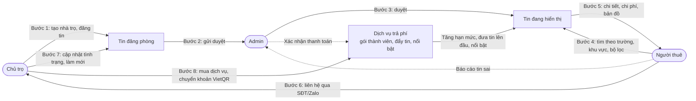

### 5.2 Người thuê: tìm phòng và liên hệ

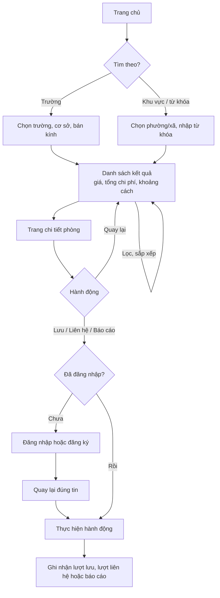

1. Người thuê vào trang chủ, chọn tìm theo trường (trường → cơ sở → bán kính) hoặc theo khu vực/từ khóa.
2. Hệ thống trả về các tin thỏa điều kiện hiển thị (6.1), kèm tổng chi phí ước tính và khoảng cách.
3. Người thuê lọc thêm, sắp xếp, mở trang chi tiết.
4. Trên trang chi tiết: xem ảnh, bảng chi phí (chỉnh số người/xe/kWh), bản đồ, tình trạng, thông tin chủ trọ.
5. Lưu, liên hệ hoặc báo cáo. Nếu chưa đăng nhập → đăng nhập rồi quay lại đúng tin.
6. Hệ thống ghi nhận lượt lưu, lượt liên hệ hoặc báo cáo.

**Ngoại lệ:** không có kết quả → gợi ý nới bán kính hoặc bỏ bớt bộ lọc · mở tin đã cho thuê/hết hạn từ link cũ → hiện nhãn, ẩn nút liên hệ · vượt giới hạn xem SĐT trong ngày → báo thử lại sau.

### 5.3 Chủ trọ: đăng và duy trì tin

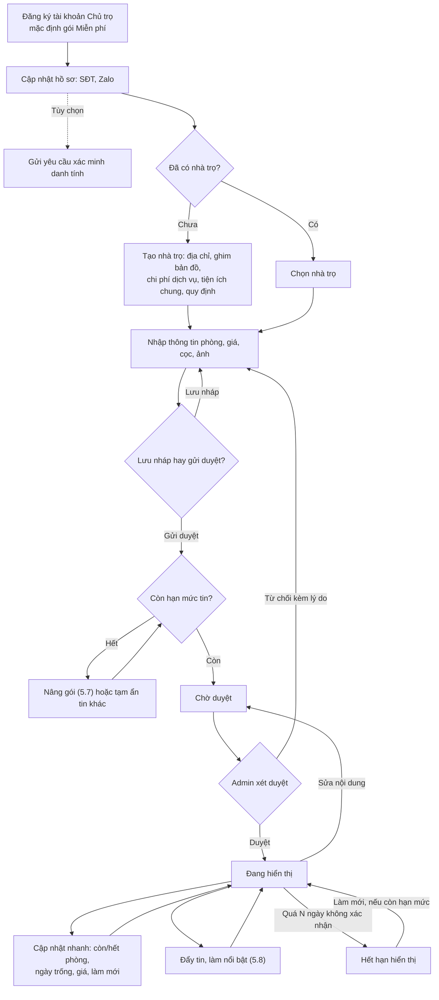

1. Đăng ký tài khoản Chủ trọ (mặc định gói Miễn phí), cập nhật SĐT liên hệ và Zalo. Có thể gửi yêu cầu xác minh danh tính bất kỳ lúc nào.
2. Tạo nhà trọ (lần đầu) hoặc chọn nhà trọ có sẵn.
3. Nhập thông tin phòng, lưu nháp hoặc gửi duyệt. Hết hạn mức tin của gói → nâng gói (5.7) hoặc tạm ẩn tin khác.
4. Bị từ chối → đọc lý do, sửa, gửi lại. Được duyệt → tin hiển thị.
5. Trong thời gian hiển thị: cập nhật nhanh (không cần duyệt), sửa nội dung (phải duyệt lại), hoặc đẩy tin/làm nổi bật để tiếp cận nhanh hơn (5.8).
6. Cho thuê xong → đánh dấu Đã cho thuê. Phòng trống lại → đánh dấu Còn trống, tin hiển thị lại ngay nếu còn hạn mức.

### 5.4 Admin: duyệt tin

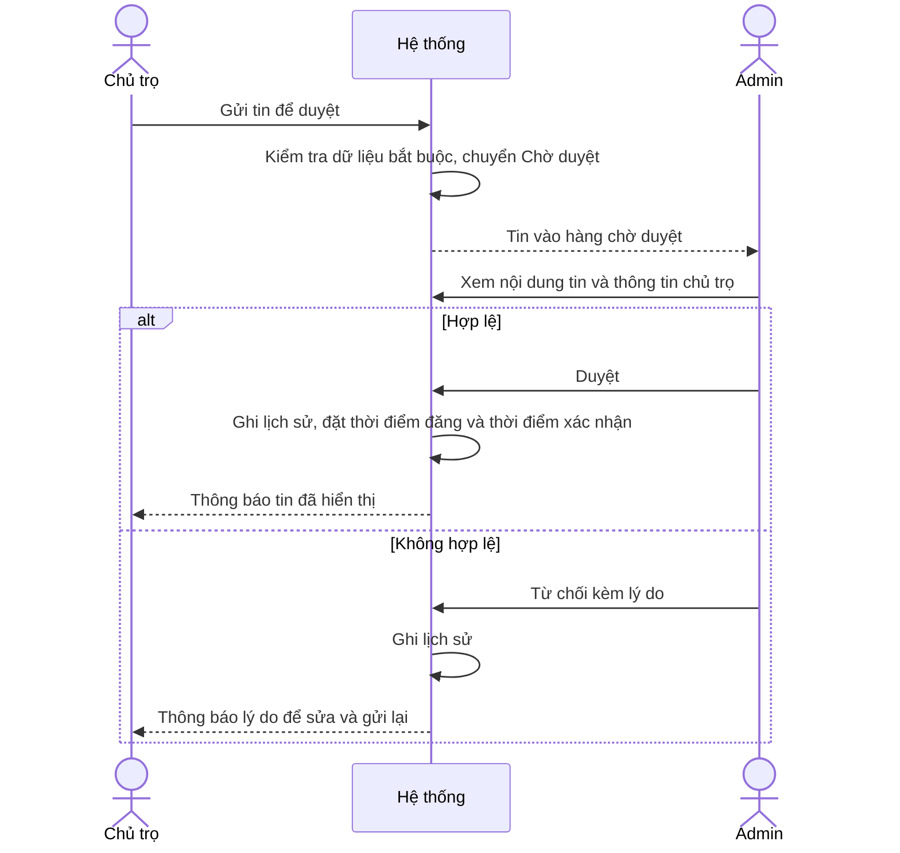

### 5.5 Báo cáo và xử lý

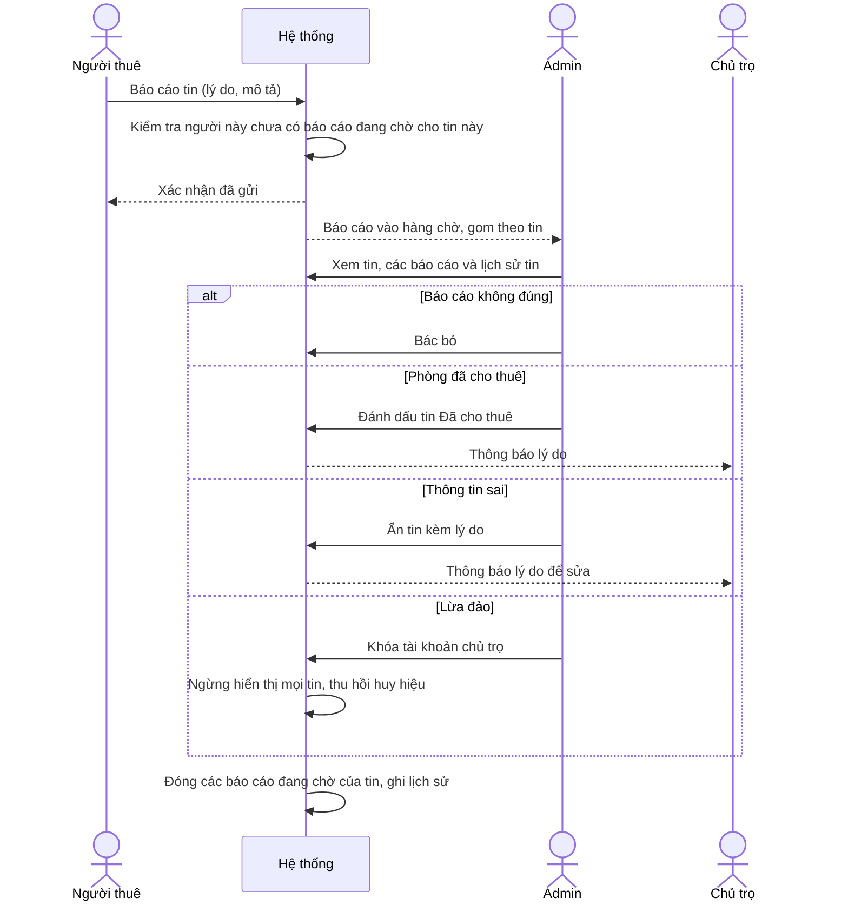

### 5.6 Xác minh danh tính chủ trọ

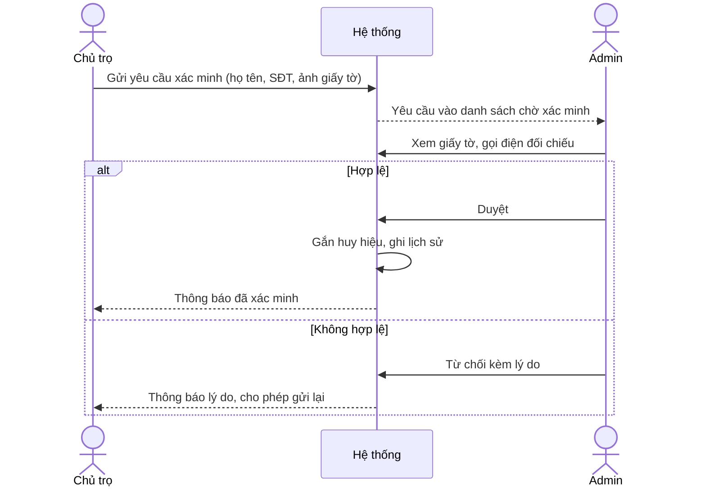

### 5.7 Mua dịch vụ và thanh toán

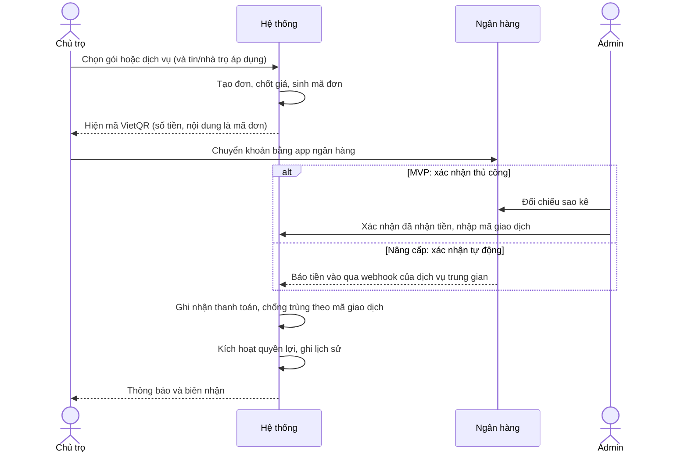

**Ngoại lệ:** quá 24 giờ chưa thanh toán → đơn hết hạn, chủ trọ tạo đơn mới · chuyển thiếu tiền hoặc sai nội dung → admin xử lý thủ công · tiền đến sau khi đơn hết hạn → admin xác nhận hoặc hoàn tiền (BR-20).

### 5.8 Đẩy tin và làm nổi bật

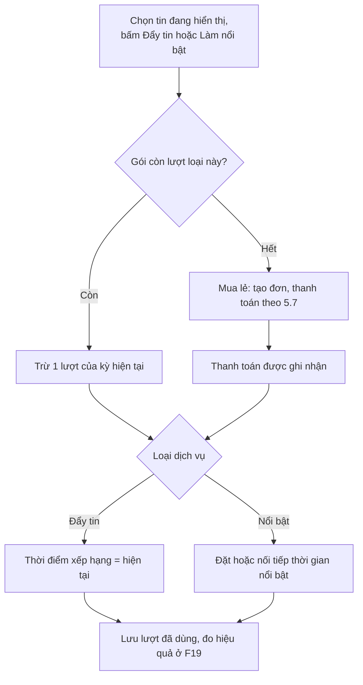

### 5.9 Xác minh tại chỗ

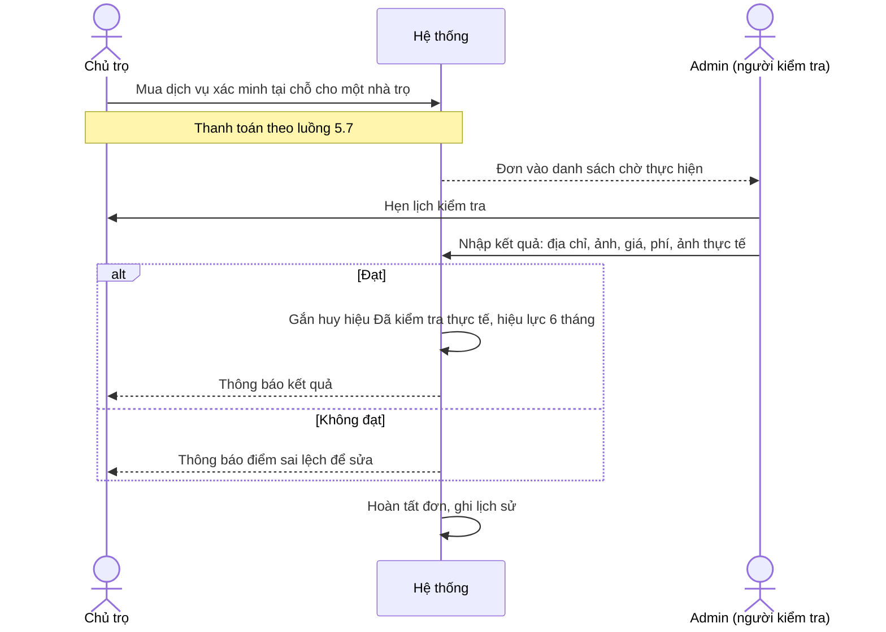

---

## 6. Trạng thái và điều kiện hiển thị

Tin đăng có **hai trục trạng thái độc lập**: *trạng thái duyệt* (do admin quyết định) và *tình trạng phòng* (do chủ trọ cập nhật), cộng thêm cờ *tạm ẩn* của chủ trọ. Tách riêng như vậy giúp logic hiển thị đơn giản và không phải tạo trạng thái ghép kiểu "đã duyệt nhưng đã cho thuê".

### 6.1 Điều kiện để tin hiển thị công khai

Một tin xuất hiện trong kết quả tìm kiếm khi **đồng thời** thỏa:

1. Trạng thái duyệt là *Đã duyệt* (`approved`).
2. Tình trạng phòng là *Còn trống* (`available`), kể cả trường hợp "trống từ ngày…" trong tương lai.
3. Chủ trọ không bật tạm ẩn.
4. Thời điểm xác nhận gần nhất nằm trong vòng N ngày (mặc định 30).
5. Tài khoản chủ trọ đang hoạt động.
6. Tin chưa bị xóa.

*Hết hạn hiển thị* là trạng thái **suy ra** từ điều kiện 4, không lưu thành một giá trị riêng.

### 6.2 Trạng thái duyệt của tin

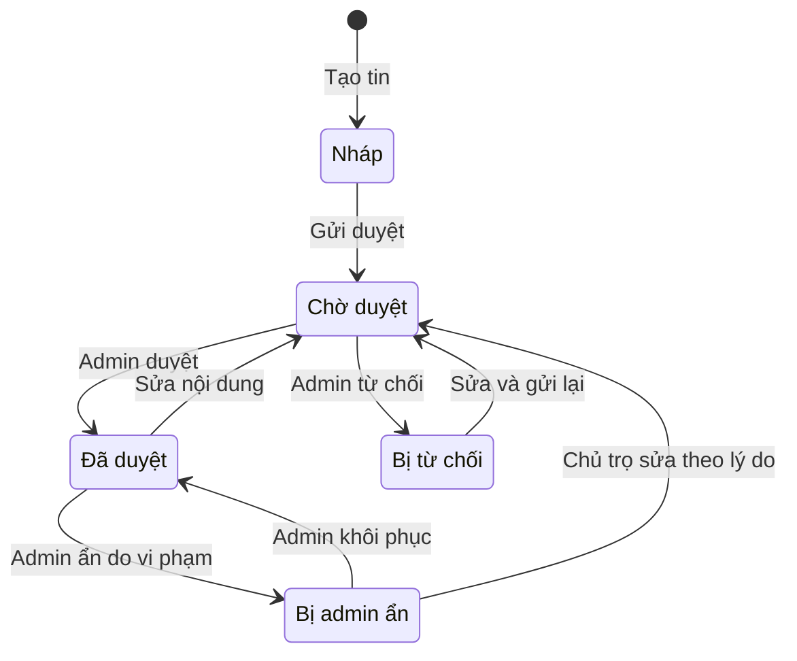

Các tab trong trang quản lý tin của chủ trọ (F12) được xác định như sau — xét từ trên xuống, dừng ở dòng đầu tiên khớp, nên mỗi tin chỉ thuộc một tab:

| Thứ tự xét | Tab | Điều kiện |
|---|---|---|
| 1 | Nháp | `draft` |
| 2 | Chờ duyệt | `pending` |
| 3 | Bị từ chối | `rejected` |
| 4 | Bị admin ẩn | `suspended` |
| 5 | Tạm ẩn | `approved` và chủ trọ bật tạm ẩn |
| 6 | Đã cho thuê | `approved` và `rented` |
| 7 | Hết hạn hiển thị | `approved`, `available`, quá N ngày chưa xác nhận |
| 8 | Đang hiển thị | Thỏa toàn bộ điều kiện ở 6.1 |

### 6.3 Tình trạng phòng

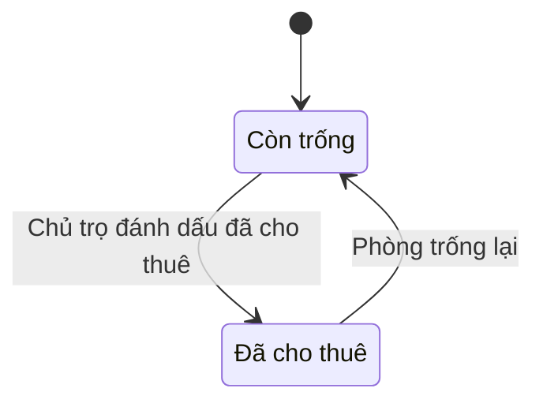

Ngày có thể vào ở lưu riêng; nếu là ngày trong tương lai, tin hiển thị "Trống từ dd/mm".

### 6.4 Trạng thái khác

| Đối tượng | Trạng thái (mã gợi ý) | Ghi chú |
|---|---|---|
| Tài khoản | Hoạt động (`active`), Bị khóa (`locked`) | Khóa/mở khóa phải có lý do |
| Xác minh chủ trọ | Chưa xác minh (`unverified`), Chờ xác minh (`pending`), Đã xác minh (`verified`), Bị từ chối (`rejected`) | Thu hồi xác minh → về `unverified`, có ghi lịch sử |
| Báo cáo | Chờ xử lý (`pending`), Đã xử lý (`resolved`), Bác bỏ (`dismissed`) | Lưu kèm hành động đã thực hiện |
| Gói thành viên | Đang hiệu lực, Đã hết hạn — **suy ra** từ ngày kết thúc | Không có gói trả phí hiệu lực → áp dụng gói Miễn phí |
| Kiểm tra tại chỗ | Chờ thực hiện (`scheduled`), Đạt (`passed`), Không đạt (`failed`) | Huy hiệu hết hiệu lực sau 6 tháng hoặc khi sửa địa chỉ (BR-27) |
| Chiến dịch quảng cáo | Sắp chạy, Đang chạy, Đã kết thúc — suy ra từ ngày; Tạm dừng (`paused`) — lưu | Chỉ chiến dịch Đang chạy mới hiển thị banner |

### 6.5 Đơn hàng

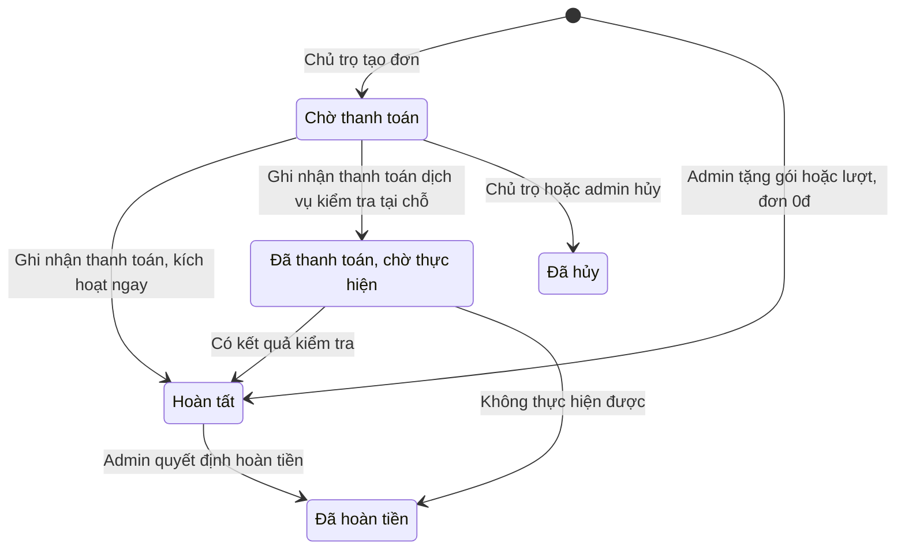

Mã gợi ý: `pending`, `paid`, `completed`, `cancelled`, `refunded`. *Hết hạn thanh toán* (chờ thanh toán quá 24 giờ) là trạng thái suy ra, không lưu riêng — cùng cách làm với tin hết hạn hiển thị ở 6.1.

---

## 7. Quy tắc nghiệp vụ

| Mã | Quy tắc |
|---|---|
| BR-01 | Email là duy nhất. Mỗi tài khoản có một vai trò: Người thuê, Chủ trọ hoặc Admin. Admin không đăng ký công khai. |
| BR-02 | Chủ trọ phải có SĐT liên hệ trước khi gửi duyệt tin đầu tiên. |
| BR-03 | Tin mới và tin bị sửa nội dung → *Chờ duyệt*, không hiển thị cho đến khi được duyệt lại. Cập nhật nhanh (tình trạng phòng, ngày trống, giá thuê, tạm ẩn/hiện, làm mới) không cần duyệt lại; thay đổi giá được lưu lịch sử. |
| BR-04 | Sửa địa chỉ/vị trí nhà trọ → mọi tin của nhà trọ đó chuyển *Chờ duyệt*. Sửa chi phí, tiện ích chung, quy định → áp dụng ngay, có ghi lịch sử. |
| BR-05 | Tin chỉ hiển thị công khai khi thỏa toàn bộ điều kiện ở mục 6.1. |
| BR-06 | Mỗi tin có 3–10 ảnh (JPG/PNG/WebP, tối đa 5 MB/ảnh) và đúng một ảnh bìa. |
| BR-07 | Nhà trọ phải khai đủ 5 khoản phí chính: điện, nước, Internet, giữ xe, phí dịch vụ. Được chọn "Miễn phí / Đã gồm" nhưng không được bỏ trống. Đây là điều kiện để gửi duyệt tin. |
| BR-08 | Giá thuê và diện tích phải nằm trong khoảng hợp lệ (ví dụ 500.000đ – 50.000.000đ/tháng; 5–500 m²) để chặn nhập sai và giá mồi. |
| BR-09 | Không ghi SĐT, link ngoài trong tiêu đề/mô tả; mọi liên hệ đi qua nút Liên hệ để thống nhất và đếm được. |
| BR-10 | Xem SĐT/Zalo cần đăng nhập; mỗi lượt được ghi nhận; tối đa X lượt/ngày/tài khoản (ví dụ 30). |
| BR-11 | Mỗi người thuê có tối đa một báo cáo đang chờ xử lý cho mỗi tin. |
| BR-12 | Tài khoản chủ trọ bị khóa → tin của chủ trọ ngừng hiển thị nhờ điều kiện 6.1, không cần đổi trạng thái từng tin; mở khóa thì tin tự hiển thị lại nếu thỏa điều kiện. |
| BR-13 | Từ chối tin, ẩn tin, từ chối/thu hồi xác minh, khóa tài khoản đều bắt buộc có lý do và được ghi lịch sử (người thực hiện, thời điểm, hành động, lý do). |
| BR-14 | Khoảng cách tính theo đường chim bay (công thức Haversine) từ tọa độ cơ sở trường tới tọa độ nhà trọ, luôn hiển thị kèm chú thích "đường chim bay". |
| BR-15 | Tin, nhà trọ, tài khoản dùng xóa mềm để giữ dữ liệu cho thống kê, lịch sử báo cáo và đánh giá về sau. |
| BR-16 | Các tham số sau cấu hình được, không viết cứng trong code: số ngày hết hạn N, giả định ước tính (người, xe, kWh, m³), giới hạn xem SĐT/ngày, số ảnh tối thiểu/tối đa, khoảng giá và diện tích hợp lệ, số tin tối đa trong khối nổi bật, thời hạn thanh toán đơn, hiệu lực huy hiệu kiểm tra tại chỗ, thông tin tài khoản nhận tiền. |
| BR-17 | Sắp xếp *Mới nhất* theo **thời điểm xếp hạng**, được đặt khi tin được duyệt lần đầu, khi phòng chuyển từ Đã cho thuê sang Còn trống, và khi chủ trọ đẩy tin (F24). Làm mới và sửa nội dung không thay đổi thời điểm xếp hạng. |
| BR-18 | Chỉ đẩy tin hoặc làm nổi bật cho tin *Đang hiển thị*. |
| BR-19 | Giá được chốt vào đơn khi tạo đơn; đổi bảng giá không ảnh hưởng đơn đã tạo. |
| BR-20 | Đơn chưa thanh toán quá 24 giờ được coi là hết hạn (suy ra khi đọc, không cần tác vụ nền). Tiền đến sau khi đơn hết hạn do admin quyết định xác nhận hoặc hoàn tiền. |
| BR-21 | Khối "Tin nổi bật" chỉ gồm tin khớp bộ lọc hiện tại, tối đa 3 tin (luân phiên ngẫu nhiên nếu nhiều hơn), luôn có nhãn "Nổi bật". Thời gian nổi bật vẫn tính khi tin không còn hiển thị và không được hoàn tiền. |
| BR-22 | Số tin *Chờ duyệt* + *Đang hiển thị* của một chủ trọ không vượt hạn mức gói hiện tại; kiểm tra khi gửi duyệt, làm mới, bỏ tạm ẩn, chuyển Còn trống. Gói hết hạn không tự ẩn tin đang hiển thị. |
| BR-23 | Lượt kèm theo gói chỉ dùng trong kỳ, không cộng dồn sang kỳ sau. Dịch vụ mua lẻ áp dụng ngay cho tin/nhà trọ đã chọn khi thanh toán được ghi nhận. |
| BR-24 | Mỗi giao dịch ngân hàng chỉ được ghi nhận cho một đơn (chống trùng theo mã giao dịch); số tiền nhận phải ≥ số tiền đơn. Xác nhận, hủy, hoàn tiền, tặng gói đều ghi lịch sử kèm người thực hiện và lý do; không sửa/xóa giao dịch đã ghi, chỉ thêm bút toán điều chỉnh. |
| BR-25 | Nâng cấp gói giữa kỳ: số tiền phải trả = giá gói mới − giá trị còn lại của gói cũ (giá đã trả × số ngày còn lại ÷ 30); gói mới có hiệu lực ngay, đủ 30 ngày. |
| BR-26 | Doanh thu ghi nhận theo tiền thực thu (ngày thanh toán), trừ khoản hoàn tiền; đơn tặng 0đ thống kê riêng, không tính doanh thu. |
| BR-27 | Huy hiệu "Đã kiểm tra thực tế" hết hiệu lực sau 6 tháng hoặc ngay khi chủ trọ sửa địa chỉ/vị trí nhà trọ. |
| BR-28 | Trả phí không thay đổi tiêu chí duyệt tin; mọi nội dung trả phí (tin nổi bật, banner quảng cáo) luôn có nhãn phân biệt với nội dung thường. |

---

## 8. Đối tượng dữ liệu chính (định hướng cho thiết kế DB)

Phần này chỉ để định hướng; chi tiết cột, kiểu dữ liệu, khóa và chỉ mục sẽ làm ở bước thiết kế DB.

| Đối tượng | Tên bảng gợi ý | Dữ liệu chính | Quan hệ |
|---|---|---|---|
| Tài khoản | `users` | Email, mật khẩu (băm), họ tên, SĐT, ảnh, vai trò, trạng thái; Zalo, trạng thái xác minh (chủ trọ); cơ sở trường đang học (người thuê) | 1 chủ trọ – n nhà trọ |
| Yêu cầu xác minh | `landlord_verifications` | Chủ trọ, ảnh giấy tờ, trạng thái, lý do, admin xử lý, thời điểm | n – 1 tài khoản |
| Tỉnh/thành, phường/xã | `provinces`, `wards` | Tên, mã hành chính | 1 tỉnh – n phường/xã |
| Trường, cơ sở | `schools`, `campuses` | Tên, tên viết tắt; cơ sở có địa chỉ, tọa độ | 1 trường – n cơ sở |
| Nhà trọ | `properties` | Chủ trọ, tên, địa chỉ, phường/xã, tọa độ, giờ giấc, quy định | 1 nhà trọ – n tin đăng |
| Phí dịch vụ | `property_fees` | Nhà trọ, loại phí, đơn giá, cách tính, ghi chú | n – 1 nhà trọ |
| Tiện ích | `amenities` | Tên, nhóm (trong phòng / chung của nhà), trạng thái | n – n với nhà trọ (`property_amenities`) và với tin (`listing_amenities`) |
| Tin đăng phòng | `listings` | Nhà trọ, tiêu đề, mô tả, loại phòng, hình thức thuê, giá, cọc, diện tích, số người tối đa, nội thất, thời hạn tối thiểu, video, trạng thái duyệt, tình trạng phòng, ngày trống, cờ tạm ẩn, thời điểm xếp hạng, thời điểm xác nhận gần nhất | n – 1 nhà trọ |
| Ảnh tin | `listing_images` | Tin, đường dẫn, thứ tự, ảnh bìa | n – 1 tin |
| Phòng đã lưu | `favorites` | Người thuê, tin, thời điểm | n – n người thuê và tin |
| Lượt liên hệ | `contact_logs` | Người thuê, tin, kênh (SĐT/Zalo), thời điểm | n – 1 tin |
| Báo cáo | `reports` | Người báo cáo, tin, lý do, mô tả, trạng thái, kết quả, admin xử lý | n – 1 tin |
| Lịch sử kiểm duyệt | `moderation_logs` | Loại đối tượng, mã đối tượng, hành động, lý do, người thực hiện, thời điểm | Gắn với tin, tài khoản, yêu cầu xác minh, báo cáo |
| Lịch sử giá | `listing_price_history` | Tin, giá cũ, giá mới, thời điểm | n – 1 tin |
| Cấu hình | `settings` | Khóa, giá trị (các tham số ở BR-16) | — |

**Nhóm thu phí và quản lý chi phí**

| Đối tượng | Tên bảng gợi ý | Dữ liệu chính | Quan hệ |
|---|---|---|---|
| Sản phẩm dịch vụ | `service_products` | Mã, tên, loại (gói thành viên / đẩy tin / nổi bật / xác minh tại chỗ), giá, thời hạn, mô tả quyền lợi, trạng thái bán; riêng gói: hạn mức tin, lượt đẩy và lượt nổi bật mỗi kỳ, ưu tiên duyệt | 1 sản phẩm – n đơn |
| Lịch sử giá dịch vụ | `product_price_history` | Sản phẩm, giá cũ, giá mới, thời điểm, người đổi | n – 1 sản phẩm |
| Đơn hàng | `orders` | Mã đơn (dùng làm nội dung chuyển khoản), chủ trọ, sản phẩm, đối tượng áp dụng (tin/nhà trọ), giá chốt, khấu trừ khi nâng cấp, số tiền phải trả, loại đơn (mua/tặng), trạng thái, lý do, các mốc thời gian | n – 1 chủ trọ, n – 1 sản phẩm |
| Thanh toán | `payments` | Đơn, số tiền, mã giao dịch ngân hàng (duy nhất), thời điểm, nguồn (thủ công/webhook), người xác nhận | n – 1 đơn |
| Gói thành viên | `subscriptions` | Chủ trọ, gói, bắt đầu, kết thúc, đơn nguồn | n – 1 chủ trọ |
| Lượt đẩy/nổi bật | `listing_boosts` | Tin, loại (đẩy/nổi bật), bắt đầu, kết thúc, nguồn lượt (gói/đơn lẻ/tặng) | n – 1 tin |
| Thống kê tin theo ngày | `listing_daily_stats` | Tin, ngày, lượt xem, lượt lưu, lượt liên hệ | n – 1 tin |
| Kiểm tra tại chỗ | `onsite_inspections` | Nhà trọ, đơn, người kiểm tra, lịch hẹn, kết quả, điểm sai lệch, ảnh thực tế, ngày kiểm tra, hiệu lực đến | n – 1 nhà trọ |
| Chiến dịch quảng cáo | `ad_campaigns` | Đối tác, ngành, vị trí, ảnh, đường dẫn, bắt đầu, kết thúc, giá trị hợp đồng, ngày thu tiền, trạng thái | 1 – n thống kê ngày |
| Thống kê quảng cáo | `ad_daily_stats` | Chiến dịch, ngày, lượt hiển thị, lượt nhấp | n – 1 chiến dịch |
| Chi phí vận hành | `expenses` | Ngày, nhóm chi phí, số tiền, mô tả, chứng từ, định kỳ, người nhập | — |

Loại phòng, hình thức thuê, mức nội thất, lý do báo cáo, lý do từ chối có thể là enum hoặc bảng danh mục nhỏ.

**Nên tính trước cho các giai đoạn sau:**

- Đánh giá sẽ gắn với `properties`, vì vậy nhà trọ chỉ xóa mềm.
- `contact_logs` là căn cứ xác định ai được phép đánh giá.
- Phí lưu dạng *đơn giá + cách tính* giúp so sánh, lọc theo tổng chi phí và tính % phù hợp mà không phải đổi cấu trúc.
- Tọa độ lưu dạng số (lat/lng). Truy vấn bán kính trong MVP: lọc nhanh theo khung tọa độ (bounding box, có chỉ mục) rồi mới tính Haversine; khi dữ liệu lớn có thể chuyển sang PostGIS nếu dùng PostgreSQL.
- Thanh toán thủ công và webhook dùng chung bảng `payments` với mã giao dịch duy nhất → chuyển sang xác nhận tự động không phải đổi DB.
- Giá luôn được chốt trong `orders` → đổi bảng giá không làm sai báo cáo doanh thu cũ.

---

## 9. Danh sách màn hình

| Khu vực | Màn hình | Chức năng |
|---|---|---|
| Công khai | Trang chủ (tìm theo trường / khu vực / từ khóa, khối Phòng nổi bật) | F07, F08, F24 |
| | Kết quả tìm kiếm (khối Tin nổi bật, banner quảng cáo) | F07, F08, F14, F24, F26 |
| | Chi tiết phòng | F09, F10, F11, F13, F15, F25 |
| | Bảng giá dịch vụ | F21 |
| | Đăng nhập, đăng ký, quên mật khẩu | F01 |
| Người thuê | Hồ sơ cá nhân | F02 |
| | Phòng đã lưu | F13 |
| Chủ trọ | Tổng quan và thống kê hiệu quả | F19 |
| | Nhà trọ của tôi (danh sách, thêm/sửa, đặt kiểm tra tại chỗ) | F04, F25 |
| | Tin đăng của tôi (các tab, cập nhật nhanh, đẩy tin, nổi bật) | F12, F14, F24 |
| | Đăng/sửa tin | F05 |
| | Gói của tôi (hạn mức, lượt còn lại, gia hạn/nâng cấp) | F23 |
| | Thanh toán đơn (mã VietQR, trạng thái) | F22 |
| | Lịch sử giao dịch, biên nhận | F22 |
| | Hồ sơ và xác minh danh tính | F02, F17 |
| Admin | Dashboard vận hành | F20 |
| | Duyệt tin | F06 |
| | Quản lý tin (tất cả tin, ẩn/khôi phục) | F06 |
| | Báo cáo vi phạm | F16 |
| | Xác minh danh tính chủ trọ | F17 |
| | Người dùng | F18 |
| | Bảng giá dịch vụ | F21 |
| | Đơn hàng, xác nhận thanh toán, tặng gói | F22 |
| | Lịch kiểm tra tại chỗ | F25 |
| | Quảng cáo đối tác | F26 |
| | Chi phí vận hành | F27 |
| | Báo cáo tài chính và KPI | F27 |
| | Danh mục (trường & cơ sở, phường/xã, tiện ích) và cấu hình | F03, BR-16 |

---

## 10. Yêu cầu phi chức năng (mức MVP)

- **Giao diện:** responsive, ưu tiên điện thoại vì người dùng chính là sinh viên.
- **Hiệu năng:** tìm kiếm phản hồi dưới 2 giây với vài nghìn tin; có phân trang; ảnh được nén và có bản thu nhỏ.
- **Bảo mật:** mật khẩu băm (bcrypt/argon2), kiểm tra quyền ở phía server, giới hạn tần suất cho đăng nhập/xem SĐT/báo cáo, chỉ nhận tệp ảnh khi tải lên.
- **Dữ liệu cá nhân:** SĐT chủ trọ chỉ hiện cho người đã đăng nhập; ảnh giấy tờ xác minh lưu ở vùng riêng tư, chỉ admin xem.
- **SEO:** đường dẫn thân thiện cho trang chi tiết (ví dụ `/phong/phong-tro-gan-dh-bach-khoa-123`), thẻ meta và ảnh chia sẻ.
- **Bản đồ:** chủ trọ tự ghim vị trí nên không phụ thuộc dịch vụ chuyển địa chỉ thành tọa độ; dùng giải pháp đơn giản như Leaflet + OpenStreetMap, hoặc Google Maps/Goong nếu cần dữ liệu Việt Nam tốt hơn.
- **Thanh toán:** không lưu thông tin thẻ hay tài khoản của người trả; webhook (nếu dùng) phải xác thực bằng khóa bí mật và xử lý chống trùng; giao dịch đã ghi không được sửa/xóa (BR-24).
- **Pháp lý khi thu tiền thật:** cần đăng ký kinh doanh, kê khai thuế và xuất hóa đơn theo quy định; MVP chỉ xuất biên nhận nội bộ. Bảng giá ghi rõ đã gồm thuế hay chưa. Điều khoản dịch vụ công bố chính sách hoàn tiền và cách hiển thị nội dung trả phí.

---

## 11. Câu hỏi cần chốt trước khi thiết kế DB

1. **Mô hình dữ liệu:** giữ 2 cấp *Nhà trọ → Tin đăng* (khuyến nghị) hay gộp 1 cấp (mỗi tin tự chứa địa chỉ và phí)? 2 cấp giúp nhập phí một lần cho cả dãy trọ và giữ được đánh giá theo địa chỉ.
2. Một tin là **một phòng cụ thể** hay **một loại phòng** có thể còn nhiều phòng trống giống nhau (cần thêm trường "số phòng trống")? Câu trả lời ảnh hưởng trực tiếp đến hạn mức tin của gói Miễn phí (Q12).
3. Một tài khoản có thể vừa là người thuê vừa là chủ trọ không? (Đề xuất MVP: một vai trò cho mỗi tài khoản.)
4. Có cho **môi giới** đăng tin không? Nếu có, cần thêm vai trò hoặc nhãn "Môi giới" trên tin.
5. Đổi giá thuê có cần duyệt lại không? (Đề xuất: không, nhưng lưu lịch sử giá.)
6. Số ngày N để tin hết hạn hiển thị? (Đề xuất 30.)
7. Có tự động tạm ẩn tin khi nhận từ X báo cáo của các tài khoản khác nhau, trước khi admin xử lý không?
8. Xác minh chủ trọ có lưu ảnh giấy tờ lâu dài không, hay xóa sau khi có kết quả và chỉ giữ kết quả?
9. Khu vực thí điểm gồm những trường/cơ sở và phường/xã nào? Có cần thêm "nhóm khu vực" theo tên quận cũ (Q.10, Bình Thạnh, Thủ Đức…) cho người dùng quen tìm không? Lưu ý một số phường mới được ghép từ phần của nhiều quận/huyện cũ nên không ánh xạ 1–1 sang quận cũ được.
10. Trong thời gian môn học có **thu tiền thật** không, hay chỉ demo với số tiền nhỏ? Nếu thu thật: tài khoản nhận tiền đứng tên ai, có đăng ký hộ kinh doanh/doanh nghiệp không? Câu trả lời quyết định cách xuất chứng từ (biên nhận hay hóa đơn).
11. Xác nhận thanh toán **thủ công** (khuyến nghị cho MVP, không tốn phí) hay dùng dịch vụ **webhook tự động** ngay từ đầu (có thể phát sinh phí dịch vụ, cần máy chủ nhận webhook)?
12. Chốt bảng giá và hạn mức gói Miễn phí (đề xuất 5 tin). Có khảo sát chủ trọ trước khi chốt không?
13. Tin đang nổi bật bị admin ẩn do vi phạm thì có hoàn tiền phần thời gian còn lại không? (Đề xuất: không, ghi rõ trong điều khoản.)